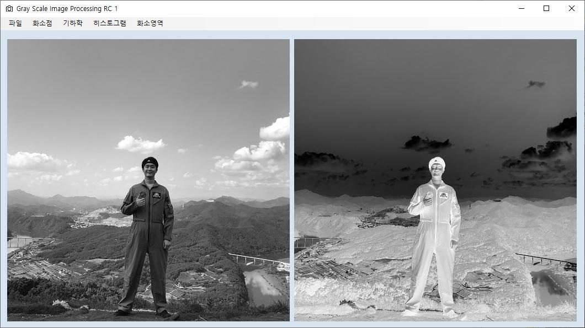

# What is a digital image

It's 2D array, each slot (pixel) in that array is just binary data that represents brightness or color.
in a greyscale image that pixel is only one number
0 => black
255 => white
greyshades => represents different brightness levels

An image is a function f(x,y): x=row, y=column
f(x,y) = i(x,y) * r(x,y)
i: is the illumination (light falling on the surface)
r: is the reflection (the fraction reflected and it depends on the surface material)

The raw storage of a digital image =  $M \times N \times k$ bits

M: rows
N: columns
k: number gray levels (bit-depth). (256 levels = 2^8, k here = 8)

# What is bit-depth

It's the number of bits used to represents the brightness of each pixel
it's rule is

$$
\text{Number of shades} = 2^{\text{bit-depth}}
$$

(here 2 because computer can only store only two values 0 and 1)

> resolution determines how many pixels the image has, while bit-depth determines how many brightness levels each pixel can represent.

# Sampling and Quantization

A real-world image is continuous. But a computer needs to represent it using numbers.
Sampling and quantization are the two steps that turn a continuous image into digital pixels.

Sampling means choosing specific locations to measure brightness.
so instead of measuring brightness everywhere we just select some positions to record as pixels.

More samples -> more pixels -> more spatial details.
Fewer samples -> fewer pixels -> lower spatial details (details can disappear).

Quantization is about what brightness value do we store,
now imagine we sampled one location it's actual brightness might be 137.42
but from later we know we need integer numbers to represent brightness,
so we do approximation 137.42 -> 137

This is quantization, we convert a measured value into one of limited number of representable values.

> The difference in one sentence:
Sampling: How many pixels?
Quantization: What value does each pixel get?

The formula of quantization is:

$$
Q(x) = \text{round}\left( \frac{x}{2^b - 1} \cdot \left(2^k - 1\right) \right)
$$

- $x$: original pixel value
- $b$: original bit-depth
- $k$: target bit-depth
- $Q(x)$: new pixel value

Given an example with our case on a pixel with value "137.42"
$$
\begin{aligned}
Q(137.42) &= \operatorname{round}\left(
\frac{137.42}{2^8 - 1} \cdot (2^4 - 1)
\right)
\end{aligned}
$$

## Pixel-wise operations

A pixelwise operation takes each pixel independently, change it's value and puts a new value back in the same place.

The general idea is:

$$
\begin{aligned}
s = T(r)
\end{aligned}
$$

r: old pixel.
T: transformation we apply.
s: new pixel.

So the transformation is simply a rule that how to convert the old pixel to a new pixel.

And that's lead us to multiple popular kind of transformations:

- Negative: inverts brightness.
- Log: reveals details in darker values.
- Gamma: adjusts overall brightness.
- Contrast stretching: expands a narrow brightness range.
- Thresholding: converts pixels into black or white.

They're all pixelwise operations, but each uses a different rule to manipulate brightness.

1- Negative
$$
\begin{aligned}
T(r) = 255-r
\end{aligned}
$$

It reverses brightness

2- Log
$$
\begin{aligned}
T(r) = c \times{log_{10}(1+r)}
\end{aligned}
$$

The important idea is that log expands dark values and compresses bright values.

c: a constant used to scale the result.
log: logarithm base 10.

But what is the constant c?
remember our image 8-bit grayscale, so:
0 <= r <= 255

the log produces values from
log(1) = 0  -> log(256) = 2.408

that's a problem, that range couldn't fit our 8-bit range, so we need a constant to scale the log output so it fits our 8-bit range.

$$
\begin{aligned}
c=\frac{255}{\log_{10}(256)}
\end{aligned}
$$

This ensures:

- Input 0 → output 0.
- Input 255 → output 255.

3- Gamma
$$
\begin{aligned}
s=255\left(\frac{r}{255}\right)^\gamma
\end{aligned}
$$

4- Contrast stretching
$$
\begin{aligned}
s=\frac{r-r_{\min}}{r_{\max}-r_{\min}}\times255
\end{aligned}
$$

Suppose our image only uses these values:
100, 110, 120, 130, 140, 150

That's a narrow range.

We want to spread it across 0–255.

We choose:
$$
r_{\min}=100
$$
$$
r_{\max}=150
$$

Let's calculate pixel 120:
$$
s=\frac{120-100}{150-100}\times255
$$

$$
s=\frac{20}{50}\times255=102
$$

Pixel 120 becomes 102.

The complete result:
Original:     100  110  120  130  140  150

Stretched:      0   51  102  153  204  255

Why does this improve contrast?
Because the original differences were only 10.

After stretching, the differences become 51.

The differences between brightness values become much more visible.

4- Thresholding
$$
s=
\begin{cases}
0 & r<128\\
255 & r\ge128
\end{cases}
$$

This is not a gradual transformation.

It makes a decision:

- Is the pixel below 128? Make it black.
- Otherwise? Make it white.

For example:
Original:     20  80  120  130  200  250

Threshold:     0   0    0  255  255  255

All intermediate brightness values disappear.
